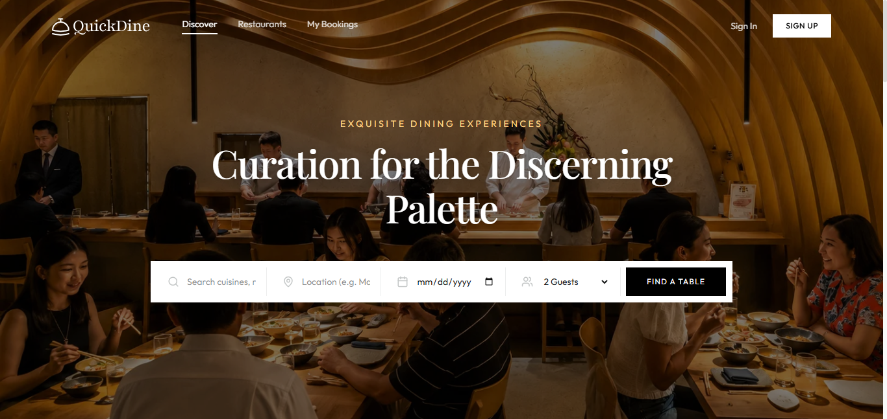
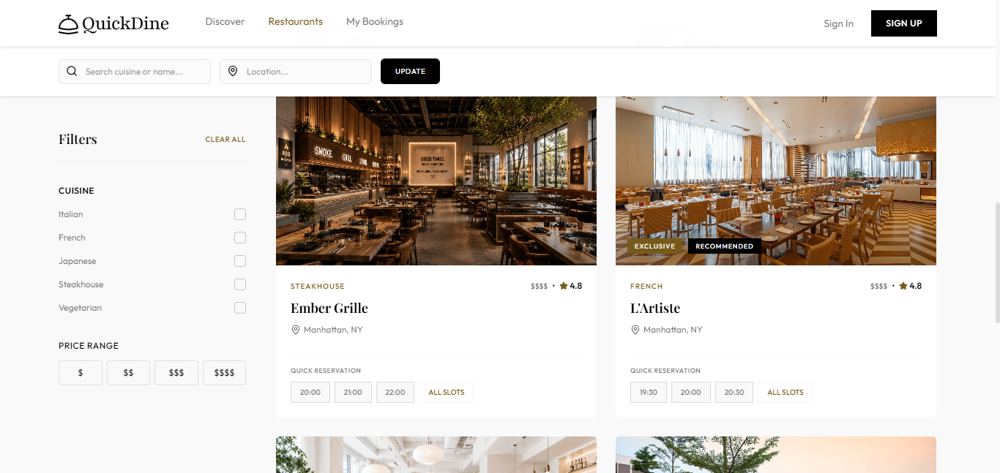
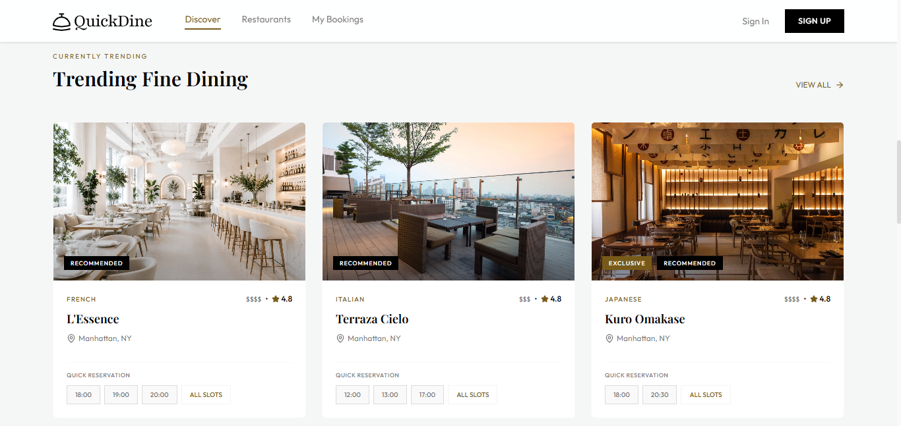
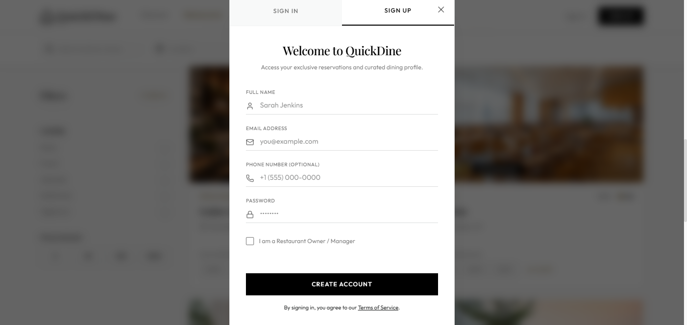
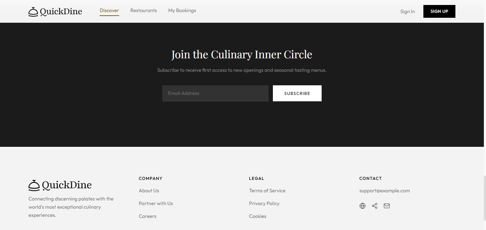

# QuickDine

QuickDine is a restaurant discovery and table-reservation frontend. It lets diners explore restaurants, browse by cuisine, and go through a reservation flow, with separate dashboard experiences for diners, restaurant owners, and administrators.

> **Portfolio and attribution:** This project was created by following a YouTube tutorial. The tutorial is credited below; this README and the live demo are provided to showcase the project in my portfolio.

## Features

- Browse and search restaurants by location, cuisine, price range, and rating.
- View restaurant details and available reservation slots.
- Follow a table-booking flow with occasion and special-request options.
- Explore role-based interfaces for diners, restaurant owners, and administrators.
- Use a responsive interface designed for desktop and mobile screens.

## Tech stack

- React 19 and TypeScript
- Vite
- Tailwind CSS 4
- React Router
- Lucide React
- React Hot Toast

## Demo note

The current frontend uses mock user data for authentication and is intended as a project demo. Signing in or registering does not create a real account.

## Run locally

Prerequisites: Node.js 18 or newer and npm.

```bash
npm install
npm run dev
```

Open the local URL printed by Vite (typically `http://localhost:5173`).

To create and preview a production build:

```bash
npm run build
npm run preview
```

## Screenshots

#### Home



#### Search



#### Trending



#### Authentication



#### Joining



## Links

This project is for portfolio and learning purposes.

- **Live deployment:** [quickdineout.com](https://quickdineout.com/)
- **YouTube tutorial:** [original creator video](https://www.youtube.com/watch?v=Olj2fkG6Nf0)
